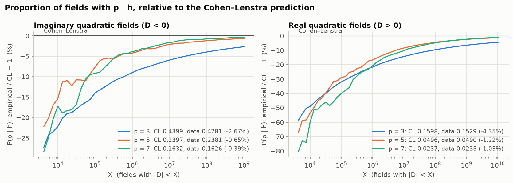
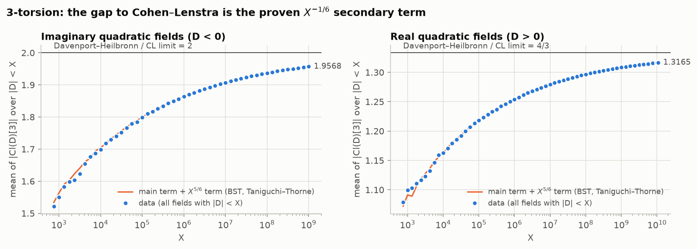

# Class groups of quadratic fields vs. Cohen–Lenstra

Class groups of every quadratic field up to a large bound, and the tools to
compare them with the Cohen–Lenstra (CL) heuristics and to watch how slowly
they converge.

| Path | Contents |
|---|---|
| `data/imag/` | Cl(D) for **all 30,396,385 imaginary quadratic fields with \|D\| < 10⁸** (unconditional) |
| `data/real/` | Cl(D) for **all 3,234,172,229 real quadratic fields with D < 1.064·10¹⁰** (under GRH) |
| `results/` | statistics vs. CL, with imaginary fields up to \|D\| < 10⁹ (303,963,510 fields): summaries, decade-by-decade tables, cumulative and windowed CSVs, fits, plots, `report.html` |
| `src/` | code to recompute, check and extend all of the above |

The LMFDB's complete list of quadratic fields stops at |D| < 2·10⁶. For
imaginary fields it also hosts the Mosunov–Jacobson class groups for all
|D| < 2⁴⁰, far beyond what is stored here. The imaginary class groups for
10⁸ ≤ |D| < 10⁹ are not stored; `src/run_imag_fast.sh` regenerates them in
about an hour.

## Data format

One line per fundamental discriminant, in increasing |D|: `D c1,c2,...,ck`,
where Cl(Q(√D)) ≅ Z/c1 × ⋯ × Z/ck with c(i+1) | c(i), so h(D) = c1⋯ck. The
trivial group is written `1`. Each xz file covers 10⁷ consecutive values of |D|:

```console
$ xzcat data/imag/imag_0000000000_0010000000.txt.xz | grep -m1 '^-3299 '
-3299 9,3
```

## How it was computed

- **Imaginary fields, unconditional.** `src/clgrp_imag.c` gets every h(D) at
  once by counting reduced forms, then builds each p-Sylow subgroup with p² | h
  explicitly (for p = 2, genus theory leaves only the squares to build).
- **Real fields, under GRH.** PARI 2.15 `quadclassunit` via `src/clgrp_pari.py`.
- **Checks.** For |D| < 6·10⁷ the two methods agree on every class group. A
  second form counter (`src/countforms.c`) reproduces every imaginary class
  number. Real class groups agree with PARI's `qfbclassno` and `bnfinit` on
  random samples, including above 2³² and 10¹⁰.

## Results at a glance

Frequencies over all fields with |D| < X, against CL. Windowed and
decade-by-decade versions are in `results/`.

**Imaginary quadratic fields** (u = 0)

| statistic | X = 10⁴ | 10⁵ | 10⁶ | 10⁷ | 10⁸ | 10⁹ | CL |
|---|---|---|---|---|---|---|---|
| P(3 \| h) | 0.3421 | 0.3784 | 0.4002 | 0.4137 | 0.4224 | 0.4281 | 0.4399 |
| P(5 \| h) | 0.2028 | 0.2213 | 0.2295 | 0.2347 | 0.2368 | 0.2381 | 0.2397 |
| P(7 \| h) | 0.1351 | 0.1482 | 0.1569 | 0.1605 | 0.1620 | 0.1626 | 0.1632 |
| mean of \|Cl[3]\| | 1.6980 | 1.7990 | 1.8633 | 1.9072 | 1.9366 | 1.9568 | 2 |
| P(3-rank = 2) | 0.0023 | 0.0070 | 0.0105 | 0.0133 | 0.0152 | 0.0166 | 0.0197 |
| P(odd part of Cl cyclic) | 0.9977 | 0.9916 | 0.9878 | 0.9845 | 0.9824 | 0.9808 | 0.9776 |
| P(4-rank = 1) | 0.3687 | 0.4105 | 0.4342 | 0.4495 | 0.4602 | 0.4681 | 0.5776 (Gerth) |

**Real quadratic fields** (u = 1)

| statistic | X = 10⁴ | 10⁵ | 10⁶ | 10⁷ | 10⁸ | 10⁹ | 10¹⁰ | 1.064·10¹⁰ | CL |
|---|---|---|---|---|---|---|---|---|---|
| P(3 \| h) | 0.0815 | 0.1087 | 0.1253 | 0.1370 | 0.1445 | 0.1494 | 0.1528 | 0.1529 | 0.1598 |
| P(5 \| h) | 0.0230 | 0.0353 | 0.0413 | 0.0454 | 0.0474 | 0.0484 | 0.0490 | 0.0490 | 0.0496 |
| P(7 \| h) | 0.0095 | 0.0142 | 0.0188 | 0.0213 | 0.0226 | 0.0232 | 0.0235 | 0.0235 | 0.0237 |
| mean of \|Cl[3]\| | 1.1630 | 1.2185 | 1.2537 | 1.2796 | 1.2968 | 1.3084 | 1.3164 | 1.3165 | 1.3333 |
| P(odd part of h trivial) | 0.8847 | 0.8353 | 0.8045 | 0.7842 | 0.7727 | 0.7659 | 0.7618 | 0.7617 | 0.7545 |
| P(h = 1), prime discriminants D = p | 0.8459 | 0.7956 | 0.7840 | 0.7717 | 0.7655 | 0.7618 | 0.7594 | 0.7593 | 0.7545 |





## What to consider

- **Compare like with like.** CL is about fundamental discriminants ordered by
  |D|, with imaginary (unit rank u = 0) and real (u = 1) fields kept apart:
  P(3 | h) tends to 43.99% for the first and 15.98% for the second.
- **p = 2 follows Gerth, not CL.** Genus theory fixes Cl[2] ≅ (Z/2)^{ω(D)−1}.
  Gerth's law for the squares 2·Cl (proved for 4-ranks by Fouvry–Klüners, and
  for imaginary 2^∞-parts by Smith) is out of reach here, because the 2-rank
  grows like log log X. Compare with the law at the observed 2-ranks instead
  (the "Gerth mixture" rows): at |D| < 10⁹, 4-rank 0 is 0.488 in the data,
  0.444 for the mixture and 0.289 in the limit. For real fields that law
  concerns the narrow class group, which is not what is stored here.
- **Convergence is slow, and for p = 3 a theorem says why.** Davenport–Heilbronn
  plus the second-order term (Bhargava–Shankar–Tsimerman, Taniguchi–Thorne) give
  a mean |Cl[3]| of about 2 − 1.36·X^{−1/6} (imaginary) and 4/3 − 0.79·X^{−1/6}
  (real). The imaginary data matches these two terms to within 2·10⁻⁵ at every
  scale (1.956836 vs. 1.956849 at 10⁹), so the gap is the predicted secondary
  term, not evidence against CL. For p ≥ 5 there is no theorem, and the gaps
  shrink faster (`plots/deviation_scaling.png`).
- **Large groups come last.** Class numbers at accessible |D| are small, real
  ones especially (the regulator takes up most of h·R), so events that need a
  large group converge slowest: at |D| < 10⁹, P(19² | h) is still 12% and
  P(3-rank ≥ 3) 56% below CL, while P(7 | h) is within 0.4%.
- **Moments vs. probabilities.** The theorems are about moments
  (CL ⇔ E[#Sur(Cl_p, A)] = |A|^{−u}). Higher moments converge more slowly:
  E|Cl[3]|² is 5.65 at 10⁹ for imaginary fields, against 6.
- **Independence and local conditions.** Compare joint frequencies with the
  product of the *observed* marginals (P(3 | h and 5 | h) = 0.10179 vs. 0.10194
  at 10⁹). Secondary terms depend on local conditions, so subfamilies such as
  the `@3split`, `@3inert` and `@3ram` rows converge at different speeds.
- **Extrapolate with care.** Fits of F∞ + a·X^{−θ} (`results/extrapolation.md`) put real h(p) = 1 at 0.751–0.755, slightly *below* 75.446%, although the data is still above it at 1.064·10¹⁰.
- **Real prime discriminants.** For D = p ≡ 1 (mod 4), CL predicts h(p) = 1
  with probability ∏_{q odd} ∏_{k≥2}(1 − q^{−k}) = 75.446%. Among the 241,401,087 prime discriminants p < 1.064·10¹⁰, 75.93% have h(p) = 1, still above the prediction but falling decade by decade from 10⁴: 0.788, 0.782, 0.770, 0.765, 0.761, 0.759, 0.758 (the last for [10¹⁰, 1.064·10¹⁰); `results/real_intervals.md`).

## Reproducing or extending

Needs cypari (or cypari2), numpy, scipy, matplotlib and gcc with OpenMP.

```bash
cd cohen-lenstra
src/run_imag_fast.sh work/imag 0 1000000000 10000000  # imaginary |D| < 1e9 (~1 h on 4 cores)
src/run_all.sh work XMAX 1000000 4 "1" XMIN           # real XMIN <= D < XMAX; resumable
src/package.sh work/real real data/real XMAX 10000000 # pack finished ranges into data/real/
gcc -O3 -march=native -fopenmp -o countforms src/countforms.c -lm
./countforms 100000000 | python3 src/verify_classnumbers.py data/imag/*.xz  # check every h
python3 src/analyze.py count real work/counts/a.csv FILES...  # counts; run in parallel
python3 src/analyze.py report real results work/counts/*.csv  # merge into results/
python3 src/extrapolate.py results 1e5
python3 src/plots.py results
python3 src/make_report.py results results/report.html
```

To extend the real fields, set XMIN to the upper end of the last file in
`data/real/`; near D = 10¹⁰ each 4·10⁷ discriminants take about an hour on 4
cores. `src/cl_predictions.py` prints the exact CL probabilities. Imaginary
fields beyond 10⁹ need theta-series methods (Mosunov–Jacobson), since the form
count grows like X^{3/2}.

## References

- H. Cohen, H. W. Lenstra Jr., *Heuristics on class groups of number fields*, LNM 1068 (1984).
- H. Davenport, H. Heilbronn, *On the density of discriminants of cubic fields II*, Proc. R. Soc. A 322 (1971).
- M. Bhargava, A. Shankar, J. Tsimerman, *On the Davenport–Heilbronn theorems and second order terms*, Invent. Math. 193 (2013).
- T. Taniguchi, F. Thorne, *Secondary terms in counting functions for cubic fields*, Duke Math. J. 162 (2013).
- F. Gerth III, *Extension of conjectures of Cohen and Lenstra*, Expo. Math. 5 (1987).
- É. Fouvry, J. Klüners, *On the 4-rank of class groups of quadratic number fields*, Invent. Math. 167 (2007).
- A. Smith, *2^∞-Selmer groups, 2^∞-class groups, and Goldfeld's conjecture*, arXiv:1702.02325.
- A. S. Mosunov, M. J. Jacobson Jr., *Unconditional class group tabulation of imaginary quadratic fields to \|Δ\| < 2⁴⁰*, Math. Comp. 85 (2016).
- H. J. J. te Riele, H. C. Williams, *New computations concerning the Cohen–Lenstra heuristics*, Experiment. Math. 12 (2003).
